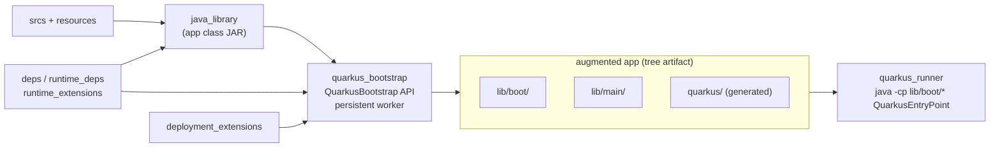

<p align="center">
  
</p>

# rules_quarkus

[](https://github.com/kinhluan/rules_quarkus/actions/workflows/ci.yml)
[](https://opensource.org/licenses/Apache-2.0)

Bazel rules that build Quarkus applications as fast-jar apps, with augmentation done by a Bazel action.
Built for **large monorepos with trunk-based development**: augmentation runs in a persistent worker,
the API is small enough to read in one sitting, and the rules are plain Starlark you can extend.

> **Not the BCR `rules_quarkus`.** The module of that name on the Bazel Central Registry is
> [quarkusio/quarkus-bazel-rules](https://github.com/quarkusio/quarkus-bazel-rules), which has a broader
> feature set. This project installs with `git_override` (see [Installation](#installation)).
> Don't use both in one workspace: they share the module name.

## Status

| Feature | Status |
|---|---|
| Compile, augment and run a Quarkus app (fast-jar layout) | ✅ |
| Augmentation in a persistent worker (JSON protocol) | ✅ |
| Quarkus 3.40.1.2 LTS | ✅ CI, default |
| Quarkus 4.0.0 | 🧪 CI, experimental |
| Bazel 7.7.1+, 8.6+, 9 | ✅ CI (7.7.2, 8.8.2 default, 9.3.2) |
| Java 21, 25 | ✅ CI. The app is compiled for and run on the JDK Bazel selects |
| `quarkus_library` shared between apps, CDI beans discovered | ✅ |
| Remote debugging (`--debug`, JDWP) | ✅ |
| `@QuarkusTest` as a Bazel test target | ❌ planned |
| Choosing the Quarkus version from a consumer's `MODULE.bazel` | ❌ planned. Today the line is selected in this repo's `MODULE.bazel` |
| `maven_install.json` lockfile | ❌ planned |
| Dev mode (live reload) | ❌ not planned yet. Use `ibazel run` |
| Native image, uber-jar | ❌ not planned yet |

## Installation

Add to your `MODULE.bazel`:

```python
bazel_dep(name = "rules_quarkus", version = "0.3.0")
git_override(
    module_name = "rules_quarkus",
    remote = "https://github.com/kinhluan/rules_quarkus.git",
    tag = "v0.3.0",  # or: commit = "<sha>" to pin an unreleased revision
)

bazel_dep(name = "rules_jvm_external", version = "7.2")

maven = use_extension("@rules_jvm_external//:extensions.bzl", "maven")
maven.install(
    name = "maven",
    artifacts = [
        "io.quarkus:quarkus-core:3.40.1.2",
        "io.quarkus:quarkus-arc:3.40.1.2",
        "io.quarkus:quarkus-arc-deployment:3.40.1.2",
        "io.quarkus:quarkus-rest:3.40.1.2",
        "io.quarkus:quarkus-rest-deployment:3.40.1.2",
        "io.quarkus:quarkus-vertx-http:3.40.1.2",
        "io.quarkus:quarkus-vertx-http-deployment:3.40.1.2",
        "jakarta.ws.rs:jakarta.ws.rs-api:4.0.0",
    ],
    version_conflict_policy = "pinned",
)
use_repo(maven, "maven")
```

`git_override` only takes effect in the root module. `bazel_dep` still needs a `version`, but the
override decides which code is fetched. Deployment modules (`*-deployment`) must be in the same
`maven.install` as their runtime modules: augmentation only sees what Bazel resolved.

## Quick start

`BUILD.bazel`:

```python
load("@rules_quarkus//quarkus:defs.bzl", "quarkus_application")

quarkus_application(
    name = "my-app",
    srcs = glob(["src/main/java/**/*.java"]),
    resources = glob(["src/main/resources/**/*"]),
    main_class = "io.quarkus.runner.GeneratedMain",  # or your @QuarkusMain class
    deps = [  # what your source code imports
        "@maven//:io_quarkus_quarkus_core",
        "@maven//:jakarta_inject_jakarta_inject_api",
        "@maven//:jakarta_ws_rs_jakarta_ws_rs_api",
        "@maven//:jakarta_enterprise_jakarta_enterprise_cdi_api",
    ],
    runtime_extensions = [
        "@maven//:io_quarkus_quarkus_arc",
        "@maven//:io_quarkus_quarkus_rest",
        "@maven//:io_quarkus_quarkus_vertx_http",
    ],
    deployment_extensions = [
        "@maven//:io_quarkus_quarkus_arc_deployment",
        "@maven//:io_quarkus_quarkus_rest_deployment",
        "@maven//:io_quarkus_quarkus_vertx_http_deployment",
    ],
    jvm_flags = ["-Djava.util.logging.manager=org.jboss.logmanager.LogManager"],
)
```

```bash
bazel run //:my-app                  # build, augment, start on :8080
curl http://localhost:8080/hello

bazel build //:my-app && bazel-bin/my-app   # or run the built launcher directly
```

[`examples/hello-world`](examples/hello-world/BUILD.bazel) is the same setup, and CI builds and
smoke-tests it on every push. When this README and the example disagree, the example is right.

## How it works



1. **Compile.** A plain `java_library` holds only your classes. `runtime_deps` stay off the compile
   classpath, so changing them doesn't recompile the app.
2. **Augment.** `quarkus_bootstrap` builds a Quarkus `ApplicationModel` from the Bazel classpath and runs
   the `QuarkusBootstrap` API: Jandex indexing, CDI, config, generated bytecode. It runs as a
   **persistent worker**, so JVM start-up and Quarkus bootstrap class loading are paid once per build
   instead of once per app.
   - Only the app's own JAR is the application artifact.
   - JARs that share a filename (several `libbuild.jar`) are staged under unique names.
   - Internal Bazel JARs are indexed so their CDI beans are found.
3. **Run.** `quarkus_runner` is a shell launcher. It finds the augmented app in runfiles and starts
   `QuarkusEntryPoint` with only `lib/boot/` on the system classpath. Quarkus' `RunnerClassLoader`
   loads `lib/main/`. The layout is the standard Quarkus fast-jar, so it deploys like a Maven build.

The Starlark is in [`quarkus/`](quarkus/) and the augmentor in
[`tools/src/main/java/io/quarkus/bazel/bootstrap/`](tools/src/main/java/io/quarkus/bazel/bootstrap/).
Both are short enough to read before you change them.

## Quarkus versions

This repo's `MODULE.bazel` has one pinned dependency profile per Quarkus line (`_PROFILES`):

```python
QUARKUS_LINE = "3"   # 3.40.1.2 LTS (default), or "4" for 4.0.0
```

A profile pins the libraries Quarkus is sensitive to (Vert.x, Jandex, ASM, CDI API, Quarkiverse) to the
versions in that line's BOM. Mixing lines, such as Vert.x 4 under Quarkus 4, breaks augmentation. CI runs
every line. 4.x is experimental: there the CDI API moved to `jakarta.cdi:jakarta.cdi-api` and Unleash has
no release yet.

The line is selected inside this repository, so it applies to the examples and CI only. In your own
workspace, pin your Quarkus version in your own `maven.install`.

## Extensions

Any Quarkus extension should work once its runtime and `-deployment` artifacts are on the classpath.
This table shows what is tested and what is only pinned:

| Extension | In `MODULE.bazel` | Augmented in CI |
|---|---|---|
| `quarkus-arc`, `quarkus-rest`, `quarkus-vertx-http` | ✅ | ✅ hello-world, demo-extensions |
| `quarkus-rest-jackson`, `quarkus-mutiny` | ✅ | ✅ demo-extensions |
| `quarkus-smallrye-health`, `quarkus-micrometer-registry-prometheus` | ✅ | ✅ demo-extensions |
| `quarkus-reactive-oracle-client`, `quarkus-reactive-mysql-client`, `quarkus-redis-client` | ✅ | ❌ |
| `quarkus-messaging-kafka`, `quarkus-messaging-rabbitmq`, `quarkus-grpc` | ✅ | ❌ |
| Quarkiverse: `quarkus-unleash`, `quarkus-langchain4j-*`, `quarkus-tika` | ✅ (versions per line) | ❌ |

Adding an extension to [`examples/demo-extensions`](examples/demo-extensions/) moves it to the right-hand
column. [CONTRIBUTING.md](CONTRIBUTING.md) explains how.

## API

### `quarkus_application`

| Attribute | Description |
|---|---|
| `name` | Target name. `bazel run :name` starts the app. |
| `srcs`, `resources` | Application sources and resources (`application.properties`, ...). |
| `main_class` | **Required.** `"io.quarkus.runner.GeneratedMain"`, or your `@QuarkusMain` class. |
| `deps` | Compile-time dependencies: what the sources import. |
| `runtime_deps` | Runtime-only dependencies (JDBC drivers, ...). Kept off the compile classpath. |
| `runtime_extensions` | Quarkus runtime extension modules. |
| `deployment_extensions` | The matching `-deployment` modules, used only during augmentation. |
| `jvm_flags` | JVM flags for the launcher. |
| `data` | Runtime files made available to `bazel run`. |
| `plugins` | Annotation processors (e.g. Lombok). |

A label that appears in more than one of `deps`, `runtime_deps` and `runtime_extensions` is
deduplicated. The macro also creates `<name>_lib` (the `java_library`) and `<name>_augmented`
(the augmented app directory).

### `quarkus_library`

A `java_library` with `-parameters`. Use it for code shared by several apps:
`srcs`, `resources`, `deps`, `extensions` (added to `deps`).

### Running and debugging

```bash
bazel run //:my-app -- --debug                 # JDWP on :5005, waits for a debugger
DEBUG=1 DEBUG_SUSPEND=n DEBUG_PORT=5006 bazel run //:my-app
ibazel run //:my-app                           # rebuild and restart on change (bazel-watcher)
```

`--debug` is consumed by the launcher. Every other argument is passed to the app.

The launcher runs on the JDK that Bazel resolved for the target (`--java_runtime_version`), shipped
in its runfiles, not on the `java` from `PATH`. To build and run on Java 25:

```bash
bazel run //:my-app --java_language_version=25 --java_runtime_version=remotejdk_25
```

Augmentation itself runs on the tool JDK (`--tool_java_runtime_version`). It can stay on 21:
reading Java 25 class files depends on the ASM and Jandex versions, not on the JDK running them.

## Requirements

| Component | Version |
|---|---|
| Bazel | 7.7.1+, 8.6+ or 9, with Bzlmod (required by rules_jvm_external 7). Development uses `.bazelversion` (8.8.2) |
| Java | 21 or 25 |
| Quarkus | 3.40.1.2 LTS, or 4.0.0 (experimental) |

## More

- [CHANGELOG.md](CHANGELOG.md): release notes and breaking changes.
- [CONTRIBUTING.md](CONTRIBUTING.md): building, testing and adding extensions.
- [AGENTS.md](AGENTS.md): repository guide for AI coding agents (and humans in a hurry).
- [Architecting Deterministic Quarkus Builds](docs/blogs/2026-03-11-bazel-support-for-quarkus.md): design and motivation.
- [Taming the Quarkus ClassLoader for Hermetic Bazel Builds](docs/blogs/2026-03-12-deep-dive-quarkus-classloader-bazel.md): class loading in detail.

## License and authors

[Apache License 2.0](LICENSE). Maintained by [@kinhluan](https://github.com/kinhluan),
[@tructxn](https://github.com/tructxn) and [@Nhannguyenus24](https://github.com/Nhannguyenus24).
Evolved from [tructxn/rule-quarkus](https://github.com/tructxn/rule-quarkus).

Community project, not affiliated with Red Hat or the Quarkus project.
